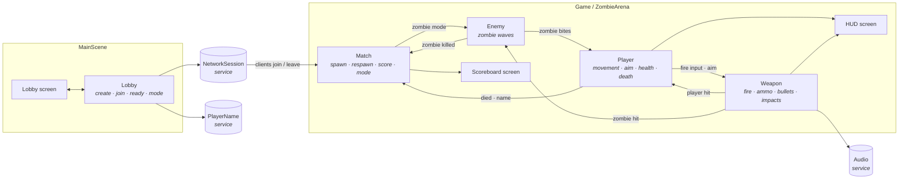
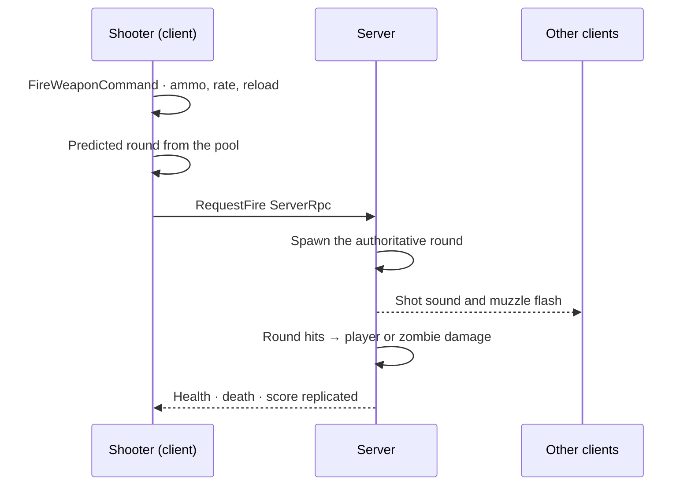

<div align="center">

# 🔥 Fireline

**A top-down multiplayer shooter for up to four players — fight each other in Deathmatch, or hold the line together against endless waves of zombies.**


</div>

---

## ✨ Features

| | |
|---|---|
| 🎮 **Two game modes** | **Deathmatch** on a city map, or **Zombie** waves on an open arena — picked by the host in the lobby. |
| 🧟 **Zombie waves** | Zombies close in from a ring around the players, every wave larger than the last. Hits flash, bleed and knock them back. |
| 👥 **1 – 4 players** | Lobbies with a join code over Unity Relay. Start alone or with friends — as soon as everyone in the lobby is ready. |
| 🎯 **Server-authoritative combat** | The server owns damage, death, respawn and score; the shooter sees a predicted round instantly. |
| 📱 **Mobile ready** | On-screen joystick, fire and reload buttons, and auto-aim at the nearest zombie on touchscreens. |
| 👁️ **Line of sight** | Other players outside your vision cone, or behind a wall, are not drawn. |
| 🏆 **Live scoreboard** | Kills, deaths and K/D for every player, replicated to all clients. Zombie kills count too. |

---

## 🕹️ Controls

| Action | PC | Mobile |
|---|---|---|
| Move | `W` `A` `S` `D` | Left on-screen stick |
| Sprint | `Left Shift` | — |
| Aim | Mouse | Automatic (nearest zombie, otherwise where you walk) |
| Fire | Left mouse button | Red button, bottom right |
| Reload | `R` (empty magazines reload by themselves) | Reload button |
| Leave match | Exit button, top left → confirm | Same |

---

## 🚀 Getting Started

### Requirements

- **Unity 6000.3.26f1** (or a later 6000.3 patch)
- A **Unity Gaming Services** project with **Authentication** (anonymous), **Lobby** and **Relay** enabled

### Run it

1. Clone the repository and open the folder in Unity Hub. Packages, including [FlowIoC](https://github.com/FlowArc/FlowIoC), resolve on the first open.
2. Link the project to your UGS project: **Edit ▸ Project Settings ▸ Services**.
3. Build the Addressables content once: **Window ▸ Asset Management ▸ Addressables ▸ Groups ▸ Build ▸ New Build ▸ Default Build Script**.
4. Open **`Assets/Modules/MainModule/Scenes/MainScene.unity`** and press Play.
5. For a second player, run a build or use **Multiplayer Play Mode**.

### Playing a match

1. **Lobby** → enter your name → choose the mode on the right → **Create**. The join code is copied to your clipboard.
2. The others enter the code and press **Join**.
3. Everyone presses **Ready**; the host presses **Start**.

> **Mobile builds:** switch the build profile to Android or iOS, set **Default Orientation** to **Landscape**, and rebuild the Addressables for that platform.

---

## 🧱 Architecture

Fireline is built on **[FlowIoC](https://github.com/FlowArc/FlowIoC)**, a signal-driven IoC framework. The game is split into self-contained **modules**; each owns its models, commands, views and a public signal surface. Modules never reference one another — they meet only in **Connectors**.



### Modules

| Module | Kind | Responsibility |
|---|---|---|
| `NetworkSession` | Service | Unity Services sign-in, Multiplayer Sessions, Relay, `NetworkManager` events, session properties |
| `PlayerName` | Service | The local player's name, kept between runs |
| `Audio` | Service | 3D sound banks (bundled with FlowIoC) |
| `Lobby` | System + screen | The lobby flow and the game-mode choice |
| `Match` | System + screen | Server rules: spawning, respawning, scoring, the mode a match plays, the scoreboard and leaving |
| `Player` | System + HUD | The networked avatar: input, movement, aim, auto-aim, camera, vision, health and death |
| `Weapon` | System | Firing, ammunition, reloading, predicted and server rounds, impacts |
| `Enemy` | System | Zombie waves: spawning, chasing, biting and taking hits |
| `UiWidgets` | System | Button hover and click sounds and glow |
| `Main` · `Screen` · `Loading` · `Connector` | Core | FlowIoC's boot, screen manager, loading screen and the connectors that wire the modules |

Each module lives in `Assets/Modules/<Name>Module` with its own `MODULE.md` card, and three assemblies: `Runtime`, `Shared` (published data) and `Signals` (its public surface).

### How a shot travels



---

## ⚙️ Tuning

Gameplay numbers live in data assets, not in code:

| Asset | What it holds |
|---|---|
| `WeaponModule/Scriptables/CD_Weapon` | Fire rate, automatic, magazine, reload time, damage, bullet speed |
| `EnemyModule/Scriptables/CD_ZombieWaves` | First wave size, growth per wave, time between waves, spawn ring, zombie health, speed, damage, knockback |
| `PlayerModule/Scriptables/CD_CameraShake` | Shake on firing |
| `Player.prefab` → `PlayerAvatarView` | Walk and sprint speed, maximum health |
| `Arena` under `MatchSystemRoot` | Spawn points, respawn delay |

---

## 📁 Project Layout

```
Assets/
├── Modules/            # Every FlowIoC module of the game
├── Prefabs/            # Player, Zombie, bullets, effects
├── Scenes/
│   ├── Game.unity          # Deathmatch city map
│   └── ZombieArena.unity   # Open arena for zombie waves
├── Sound/  Animations/  Art/
└── AddressableAssetsData/  # Screens and audio banks
```

`AGENTS.md` / `CLAUDE.md` carry FlowIoC's architecture rules for contributors and coding assistants.

---

## 🗺️ Known Limitations

- Zombies walk straight at their target; there is no NavMesh, so walls do not stop them.
- Mobile auto-aim targets zombies only; in Deathmatch a phone player aims where they walk.
- There is no reload sound clip yet (`WeaponModule/Resources/Audio/CD_AudioBank`).

---

## 🙏 Credits

- **[FlowIoC](https://github.com/FlowArc/FlowIoC)** — architecture framework
- **Colorful City** by Triangularity — city environment
- **Survivalist** — character model and animations
- Unity **Netcode for GameObjects**, **Multiplayer Services**, **Input System**, **URP**

<div align="center">

Made by **Talha Enes İslamoğlu**

</div>
